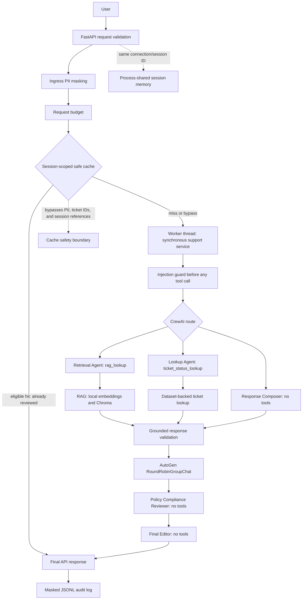

# Ola Domain Support Agent — Capstone

**Track:** Ola (Business Operations / Customer Support)

## 1. Project overview

This capstone combines a deterministic support-ticket dataset with policy RAG,
CrewAI routing, session memory, guardrails, a FastAPI/WebSocket API, offline
AutoGen review, governance, budgets, caching, and evaluation. The 12 policies
are fictional capstone data, not official Ola policy. Batches A–D are locked;
Batch E adds documentation and acceptance checks without changing their logic.

## 2. Architecture



The async FastAPI boundary offloads the unchanged synchronous CrewAI workflow to
a worker thread. Session memory remains process-shared and keyed by session ID.
Only reviewed, stateless policy/fallback responses are eligible for caching;
PII, ticket IDs, and session-dependent follow-ups bypass it.

## 3. Repository structure

```text
agents/            CrewAI orchestration, MockLLM, response/audit schemas
api/               FastAPI HTTP/WebSocket routes, service, logging, schemas
budgeting/         Request token, cost-estimate, and runtime budgets
cache/             Bounded normalized response cache
data/              Deterministic dataset and evaluation/calibration artifacts
evaluation/        Ticket, retrieval, and end-to-end evaluators
governance/         Least-autonomy policy and risk register
guardrails/         PII, prompt-injection, and groundedness checks
knowledge_base/    12 policy documents, manifest, and loader
memory/             Session-scoped ticket-reference memory
rag/                Chunking, embeddings, Chroma, retrieval, calibration
review/             Offline AutoGen review stage
scripts/            Demos, runtime validation, and final acceptance runner
tests/              Deterministic unit and integration tests
tools/              Ticket and RAG tool adapters
transcripts/        Redacted, query-safe validation evidence
dataset.py          Deterministic 50-ticket generator
requirements.txt    Pinned Python dependencies
RUBRIC_MAP.md       A–AT rubric-to-code and evidence map
```

## 4. Dataset

### Reproducibility choices

- **Seed:** `1`
- **Number of records:** `50`
- **Required categories:** Billing, Technical Issue, Account Access, Product Defect, General Inquiry
- **Category weights:** `0.22, 0.26, 0.18, 0.14, 0.20`
- **Required statuses:** Open, In Progress, Escalated, Resolved, Closed
- **Status weights:** `0.18, 0.27, 0.10, 0.27, 0.18`
- **Resolution-time range:** `1–120 hours`
- **Resolution-time rationale:** the simulated range covers simple same-day support issues through multi-day investigations while keeping the dataset compact and easy to validate.
- **Non-Escalated-status escalation probability:** `0.08`
- Any ticket whose current status is `Escalated` is always generated with `escalated=True`.
- Records are generated from the seed and weights; individual records are never hand-edited to satisfy the percentage constraint.

### Run

```bash
python dataset.py
```

This validates the dataset, writes `data/support_tickets.json`, and prints category counts, status counts, and the escalated-ticket percentage.

### Test

```bash
python -m pytest -q
```

## 5. Knowledge base

The knowledge base contains these 12 topics:

1. Ticket priority classification
2. SLA by severity
3. Escalation matrix
4. Refund and compensation
5. Customer communication channels
6. Business hours and holiday support
7. Repeat complaint handling
8. Service credit
9. Feedback collection
10. VIP customer handling
11. Outage communication
12. Ticket data retention

All policies are fictional and written specifically for this capstone; they are
not official Ola policies. Each document has a stable document ID, which the
loader preserves so later RAG evaluation can map retrieved chunks back to their
parent documents.

Validate S2 and the full project with:

```bash
python -m pytest -q
```

To inspect the loaded knowledge base as JSON, optionally run:

```bash
python -m knowledge_base.loader
```

## 6. RAG pipeline

The two independent indexing paths use deterministic character chunks (500
characters with 100 characters of overlap) and sentence chunks (up to 2 policy
sentences per chunk). Both use the free local
`sentence-transformers/all-MiniLM-L6-v2` model, which is run on CPU and does not
require a paid API key or hosted inference.

The paths are stored separately in persistent ChromaDB collections:
`ola_support_fixed` and `ola_support_sentence`. Every chunk keeps its parent
document ID and metadata so later evaluation can map retrieved chunks back to
source documents for document-level precision and recall.

Both collections use Chroma's cosine distance. Retrieval returns that distance
and calculates similarity as `1 - distance`; no production retrieval threshold
has been selected. No chunking strategy has been declared superior.

## 7. Chunking strategies

The fixed path uses 500-character chunks with 100-character overlap. The
sentence path groups up to two complete policy sentences. The validated
knowledge base produces 14 fixed chunks and 27 sentence chunks. Each collection
is maintained separately, and repeated indexing uses Chroma `upsert`.

Build or refresh both indexes with:

```bash
python -m rag.vector_store
```

Run the two retrieval smoke queries against both collections with:

```bash
python -m rag.retrieval
```

## 8. Calibration and thresholds

Calibration measures the actual top-1 cosine distance from both `fixed` and
`sentence` collections for each query, then derives similarity as
`1 - distance`. It compares the lowest observed in-scope similarity with the
highest observed out-of-scope similarity separately for each strategy. When
the ranges are strictly separated, the strategy threshold is their midpoint:

```text
threshold = (max_out_of_scope_similarity + min_in_scope_similarity) / 2
```

No preset threshold is used. If the measured ranges overlap or results are
missing, calibration marks that strategy for review and selects no threshold.
Calibration does not select an overall winning chunking strategy.

Required calibration queries:

- In scope: “What is the response SLA for a P1 critical ticket?”
- In scope: “When should a repeated unresolved complaint be escalated?”
- In scope: “When can service credit be considered?”
- Out of scope: “Who won the FIFA World Cup?”
- Out of scope: “How do I bake a chocolate cake?”

The following measurements were recorded in the external local ChromaDB
validation environment (Python 3.13.6, ChromaDB 1.5.9,
sentence-transformers 5.7.0, pytest 8.4.2). They were not measured inside
Replit. Replit's package firewall prevents rerunning ChromaDB validation here.
No preset threshold was used. The per-query evidence is also recorded in
`data/calibration_results.json`; top-1 document/chunk IDs not present in the
external report are left unknown rather than inferred. The artifact derives
cosine distances as `1 - similarity`; the supplied report listed similarities,
not raw distances.

| Strategy | Minimum in-scope similarity | Maximum out-of-scope similarity | Empirical threshold |
| --- | ---: | ---: | ---: |
| Fixed | 0.5551766157150269 | 0.09674376249313354 | 0.3259601891040802 |
| Sentence | 0.5762889385223389 | 0.10227882862091064 | 0.33928388357162476 |

Per-query top-1 evidence from that local run:

| Strategy | Query | Top-1 document / chunk | Similarity |
| --- | --- | --- | ---: |
| Fixed | Q1 — P1 response SLA | KB-002 / KB-002-fixed-000 | 0.5551766157150269 |
| Fixed | Q2 — repeat complaint escalation | KB-007 / KB-007-fixed-000 | 0.7071335315704346 |
| Fixed | Q3 — service credit | KB-008 / KB-008-fixed-000 | 0.6972638964653015 |
| Fixed | OOS1 — FIFA World Cup | Not reported | 0.09674376249313354 |
| Fixed | OOS2 — chocolate cake | Not reported | 0.02743762731552124 |
| Sentence | Q1 — P1 response SLA | KB-003 / KB-003-sentence-000 | 0.5762889385223389 |
| Sentence | Q2 — repeat complaint escalation | KB-007 / KB-007-sentence-001 | 0.6403507590293884 |
| Sentence | Q3 — service credit | KB-008 / KB-008-sentence-000 | 0.7027689814567566 |
| Sentence | OOS1 — FIFA World Cup | Not reported | 0.10227882862091064 |
| Sentence | OOS2 — chocolate cake | Not reported | 0.02854984998703003 |

Both measured score ranges were separated, so each strategy has its own
empirical threshold. The subsequent external Batch A evaluation compared both
strategies with real ChromaDB and selected sentence chunking for production;
the measured comparison is documented below.

Production `rag_lookup` grounded generation uses raw retrieved policy text
and, after the raw top-1 passes the calibrated threshold, sentence siblings
from only the parent documents present in raw top-k. It emits complete,
punctuation-terminated sentences verbatim, discarding incomplete chunk
fragments. It preserves policy values and does not join fragments across
chunks. If the raw top-1 is below the threshold, or no relevant complete
sentence is available, it returns exactly:
“I don't know based on the available support policies.” The deterministic
MOCK_LLM-compatible demonstration set contains five in-scope queries and one
out-of-scope cake query.

Answer metadata separates `top1_document_id` and `top1_chunk_id` (the rank-one
raw vector result) from `sources` (only evidence chunks that contributed
sentences to the answer). Each source identifies its `retrieval_origin` as
`vector_search` or `parent_expansion`. Expanded siblings have no similarity
score because they were fetched by parent metadata rather than vector search.

1. “What is the response SLA for a P1 critical ticket?”
2. “When should a repeated unresolved complaint be escalated?”
3. “When can service credit be considered?”
4. “What support is available outside standard business hours?”
5. “How should customers be informed during a widespread outage?”
6. Out of scope: “How do I bake a chocolate cake?”

Build both indexes, calibrate, and run the grounded demonstrations with:

```bash
python -m rag.vector_store
python -m rag.calibration
python -m rag.grounded_generation
```

These commands require the pinned dependencies and a locally accessible
ChromaDB installation. The thresholds above are externally measured local
results; Replit's package firewall still prevents rerunning the ChromaDB-backed
commands inside this environment.

Run all project tests with:

```bash
python -m pytest -q
```

## 9. Retrieval evaluation

The formal comparison uses the same five queries for both fixed and sentence
chunking. Each query retrieves `top_k=3` chunks; their `document_id` values are
deduplicated in retrieval order before scoring, so multiple chunks from one
policy do not inflate document-level precision.

| ID | Query | Relevant parent document IDs |
| --- | --- | --- |
| Q1 | What is the response SLA for a P1 critical ticket? | KB-002 |
| Q2 | When should a repeated unresolved complaint be escalated? | KB-003, KB-007 |
| Q3 | When can service credit be considered? | KB-008 |
| Q4 | What support is available outside standard business hours? | KB-006 |
| Q5 | How should customers be informed during a widespread outage? | KB-011 |

For each strategy and query, `evaluation/retrieval_eval.py` records the raw
chunk IDs, parent IDs before and after deduplication, true-positive count, and
the visible numerator and denominator for each metric:

- `precision = true_positives / unique_retrieved_parent_documents`
- `recall = true_positives / relevant_parent_documents`

Strategy aggregates are unweighted means across the five query-level precision
and recall values. Selection prioritizes higher mean recall, then higher mean
precision; a tie uses correct rank-one retrieval on Q1/Q2 and then fewer
irrelevant parent documents. An exact tie remains unresolved rather than
choosing a strategy arbitrarily.

The following real-Chroma measurements were supplied from external validation;
they were **not measured inside Replit**:

| Strategy | Query | Precision arithmetic | Recall arithmetic |
| --- | --- | --- | --- |
| Fixed | Q1 | 1/3 = 0.3333333333333333 | 1/1 = 1.0 |
| Fixed | Q2 | 2/3 = 0.6666666666666666 | 2/2 = 1.0 |
| Fixed | Q3 | 1/3 = 0.3333333333333333 | 1/1 = 1.0 |
| Fixed | Q4 | 1/3 = 0.3333333333333333 | 1/1 = 1.0 |
| Fixed | Q5 | 1/3 = 0.3333333333333333 | 1/1 = 1.0 |
| Sentence | Q1 | 1/2 = 0.5 | 1/1 = 1.0 |
| Sentence | Q2 | 2/2 = 1.0 | 2/2 = 1.0 |
| Sentence | Q3 | 1/2 = 0.5 | 1/1 = 1.0 |
| Sentence | Q4 | 1/2 = 0.5 | 1/1 = 1.0 |
| Sentence | Q5 | 1/2 = 0.5 | 1/1 = 1.0 |

| Strategy | Mean precision | Mean recall | Critical rank-one hits | Irrelevant parent documents |
| --- | ---: | ---: | ---: | ---: |
| Fixed | 0.40 | 1.00 | 2 | 9 |
| Sentence | 0.60 | 1.00 | 1 | 4 |

Recall tied at 1.00, so the decision hierarchy selects sentence on its higher
mean precision (0.60 vs 0.40). The production configuration is
`PRODUCTION_STRATEGY = "sentence"` with its corresponding calibrated
`PRODUCTION_THRESHOLD = 0.33928388357162476`. Production context depth is
`PRODUCTION_TOP_K = 5`; this is separate from the evaluation's `top_k=3`, and
the empirical fallback threshold still checks top-1 similarity.

#### Production answer context

Production grounded answering uses these stages:

1. Run sentence-vector retrieval with the unchanged raw `top_k=5`.
2. Apply the empirical out-of-scope threshold using only raw top-1 similarity.
   If that check fails, return the exact fallback without expanding context.
3. Fetch sentence siblings only for parent document IDs present in the raw
   top five. This is a metadata-filtered Chroma `get`, not a second vector
   search; raw vector scores are not changed and no score is assigned to
   expanded siblings.
4. Select complete, relevant policy sentences deterministically from raw hits
   and expanded siblings, preserving source chunk IDs and retrieval origin.

The supplied real-Chroma example returned KB-002's generic SLA explanation in
raw rank 3, while the P1 SLA chunk (`KB-002-sentence-000`) was rank 10. Since
KB-002 was already present in raw top five, parent expansion exposes its
siblings without increasing `top_k` or admitting chunks from other documents.
Task 5 remains a raw retrieval comparison at `top_k=3`; parent expansion is
not used to calculate or rewrite its precision and recall metrics.

The supplied external summary did not include raw chunk IDs or retrieved parent
ID lists. Those identity fields are `null` in
`data/retrieval_evaluation_results.json`, rather than being inferred; all
reported query-level arithmetic, aggregates, and the production decision are
preserved. The external report states that its full test suite had 68 passing
tests. Replit's package firewall still prevents rerunning real ChromaDB
measurements here. The evaluation CLI preserves this locked external artifact
instead of replacing it with a pending or mock result.

## 10. Ticket lookup and escalation score

`tools.ticket_lookup.check_support_ticket_status(record_id)` reads
`SUPPORT_TICKETS` directly from `dataset.py`; it does not use a database or a
second ticket dataset. It returns the record ID, status, resolution time,
age signal, escalation score, recommendation flag, and current cutoff. An
unknown ID raises `ValueError` with `Support ticket not found: <record_id>`.

The score uses the generated `escalated` flag and ticket age:

```text
age_signal = days_since_created / 30
escalation_score = 0.65 * int(escalated) + 0.35 * age_signal
```

The weights sum to 1. The dataset contains 10 escalated and 40 non-escalated
tickets. The 0.65 flag weight is greater than the age component's maximum
possible contribution of 0.35, so a ticket with the escalated flag always
scores above any non-escalated ticket, regardless of age. The 0.35 age weight
still increases pressure for older unresolved tickets.

The distribution is computed from all 50 generated tickets using the
nearest-rank percentile method (`rank = ceil(p * n)`, with a one-based rank).
The 80th-percentile age is 25 days (rank 40 of 50). The chosen cutoff is the
age-weighted P80:

```text
recommendation_threshold = 0.35 * (25 / 30) = 0.2916666666666667
```

Only tickets whose current status is `Open` or `In Progress` are eligible for
a *new* escalation recommendation; already-escalated, resolved, and closed
tickets are not recommended for another escalation. This keeps old unresolved
tickets eligible at the dataset's P80 age while retaining the stronger
escalated-flag signal.

| Measure | Observed value |
| --- | ---: |
| Ticket count | 50 |
| Escalated flag: true / false | 10 / 40 |
| `days_since_created` min / median / P80 / max | 0 / 15 / 25 / 30 |
| Escalation score min / median / P80 / max | 0 / 0.22166666666666665 / 0.35 / 1 |
| Escalated-flag weight | 0.65 |
| Normalized-age weight | 0.35 |
| Recommendation threshold | 0.2916666666666667 |
| Tickets in eligible statuses (`Open`, `In Progress`) | 17 |
| Recommended among eligible tickets | 7 |

The exact generated report, including percentile rank, counts, formula, and
weights, is in `data/ticket_distribution.json`. Recompute it with
`python -m evaluation.ticket_distribution`.

Example lookups:

```python
from tools.ticket_lookup import check_support_ticket_status

check_support_ticket_status("TKT-0007")
# In Progress, score 0.8016666666666667, escalation_recommended=True

check_support_ticket_status("TKT-0001")
# Closed, score 0.27999999999999997, escalation_recommended=False
```

## 11. CrewAI agents

The orchestration defines three agents: Retrieval Agent (RAG tool only), Lookup
Agent (ticket-status tool only), and Response Composer (no tools). Policy and
ticket requests are routed to the appropriate specialist, followed by the
composer. `run_support_crew(query, session_id)` calls `Crew.kickoff()` when the
CrewAI runtime is available, validates its output as `SupportResponse`, and
records a trace ID, participating agents, tool arguments, results, and
invocation counts in the returned audit record.

## 12. MOCK_LLM / offline execution

`MOCK_LLM` subclasses CrewAI's documented `BaseLLM` interface when CrewAI is
installed. It makes no network calls and chooses tools from their declared
argument schemas (`query` or `record_id`), not from tool-name substrings.
Only explicit tool/function result messages count as tool results; an
`Observation:` example or an assistant tool-call message is not treated as one. The RAG
adapter calls the existing grounded-generation function with the selected
sentence strategy, its calibrated threshold, and production context depth 5.
The ticket adapter calls the existing `check_support_ticket_status` function.

`ReplayChatCompletionClient` provides the deterministic offline AutoGen review
path. Neither local model adapter requires a paid model API key.

## 13. Session memory

Session memory uses LangChain Core's `InMemoryChatMessageHistory` and
`RunnableWithMessageHistory`, keyed by `session_id`. It carries a ticket ID
from a previous turn only within that session. HTTP and WebSocket execution
share the same process-level store; the async API calls the unchanged synchronous
service in a worker thread and awaits each WebSocket message before continuing.

## 14. Guardrails

Input phone numbers are masked before routing or model calls; injection checks
run before any CrewAI tools; and the final policy/ticket answer is rejected
unless it matches upstream grounded-generation or ticket-lookup evidence.
Every emitted support response is validated by the Pydantic `SupportResponse`
model.

### Current Replit dependency and verification status

CrewAI and ChromaDB are unavailable in this Replit environment. The pinned
ChromaDB wheel returned HTTP 403 from the package firewall, so this workspace
cannot run a real CrewAI kickoff, inspect persistent Chroma collections, or
rerun real retrieval. No fake runtime is substituted. The deterministic local
AutoGen review path and source-level Batch A–D logic remain in place.

The Replit-safe Batch E suite reported:

```bash
python -m pytest -q --ignore=tests/test_vector_store.py --ignore=tests/test_retrieval.py -rs
```

Result: **159 passed, 8 skipped, 4 warnings**. The full `python -m pytest -q`
is dependency-blocked by missing ChromaDB during collection/execution. The
runner records five dependency-blocked acceptance checks, zero real failures,
and a passing `pip check`; see `transcripts/final_acceptance.txt`.

See `transcripts/crew_demo.txt`, `transcripts/memory_demo.txt`, and
`transcripts/guardrails_demo.txt` for the captured results and the CrewAI
dependency blocker. The user also supplied a local report with 14 fixed / 27
sentence Chroma records and 17/17 Batch D tests; these were not Replit runs.
The latest local results are summarized in section 31.

### Batch B1.1 — Native CrewAI runtime hardening

With CrewAI 1.15.25's native function-calling path, `MockLLM` returns a native
tool-call list and leaves execution to CrewAI. On the next LLM call it reads the
actual returned tool/function message and builds the deterministic response;
it does not manually invoke `available_functions`. Tool selection remains based
on declared required arguments (`query` for RAG and `record_id` for tickets).
The final ticket schema and groundedness check include the lookup's actual
`resolution_time_hours`.

Failures are reported in `CrewAudit.error` with an execution stage such as
`crew_construction`, `kickoff`, `tool_call`, `mock_llm_tool_result`,
`final_response_parse`, `pydantic_validation`, or `groundedness_validation`.
The external-runtime diagnostic command is:

```bash
python -m scripts.validate_crewai_runtime
```

It exercises policy, ticket, a same-session ticket follow-up, and a new-session
isolation check; it prints the response and audit details for each case and
returns a failing exit code if a case fails. Run it in an environment with the
pinned CrewAI and ChromaDB dependencies available. The Replit environment cannot
complete a real CrewAI kickoff while its ChromaDB wheel is blocked. External
validation was pending at this intermediate B1.1 checkpoint; the later
Batch E user-supplied local validation is summarized below.

The diagnostic was also run in Replit. Policy, ticket, and the same-session
follow-up reported `blocked_dependency` at `crew_construction` because
`crewai` is not installed; the new-session isolation check returned its valid
fallback response. Separately, the external local run completed the real policy
kickoff with one `rag_lookup` call, a completed audit, and valid Pydantic
response. That earlier report noted a generic SLA explanation rather than
numeric P1 targets; it is preserved as an interim observation and is not the
latest end-to-end result.

### Batch B1.1.1 — RAG tool-result serialization

The external local B1.1.1 report confirmed that the real ticket flow, session
follow-up, and isolation passed, while the policy crew invoked `rag_lookup`
before failing to parse the returned tool message. The adapter's
CrewAI-facing `_run` returns JSON text; its audit result is the corresponding
mapping. The adapter now makes that JSON contract strict and includes the
retrieval's top-one document and chunk IDs.

`MockLLM` normalizes only content from explicit tool-result messages. It accepts
mappings, Pydantic models, UTF-8 bytes, fenced JSON, and a JSON object wrapped
in tool-result framing. Parse failures report the actual result type and a
300-character preview, without including prompts. The raw vector strategy,
ranking, threshold, and top-k remain unchanged; parent sibling expansion is a
separate post-threshold context step.

Historical Replit-safe validation after the tool-result and parent-expansion
tests (the current Batch E count is reported above):

```text
114 passed, 2 skipped, 4 warnings
```

The real CrewAI kickoff tests remain skipped in Replit because CrewAI is
unavailable here. The user supplied the actual external Chroma top five for the
P1 SLA query: KB-003-sentence-000 (0.576289), KB-003-sentence-001 (0.537036),
KB-002-sentence-002 (0.534301), KB-001-sentence-000 (0.526174), and
KB-010-sentence-000 (0.486308). The numeric P1 sibling
KB-002-sentence-000 was rank 10 (0.393418), while its parent KB-002 was already
present at raw rank 3. At this interim checkpoint, parent expansion was covered
by Replit-safe fake-collection tests but an external Chroma rerun had not yet
been reported. The user-supplied later Batch E local suite result is reported
separately and must not be confused with Replit execution.

## 15. FastAPI endpoints

The API is available as `api.app:app`. Importing it does not start a server.

| Route | Purpose |
| --- | --- |
| `POST /ask` | Validate a support question, call the existing CrewAI service, and return the existing `SupportResponse` fields with trace and session IDs. |
| `GET /ticket/{record_id}` | Return the existing deterministic ticket lookup fields. |
| `WS /ws/chat` | Accept one JSON support question per message and retain the connection's session ID for follow-ups. |

Run the API with:

```bash
uvicorn api.app:app --host 0.0.0.0 --port 8000
```

HTTP errors and WebSocket validation failures return safe messages. The API
does not return CrewAI diagnostics, prompts, or stack traces. Each HTTP
request and WebSocket message gets a UUID trace ID.

## 16. WebSocket flow

Connect a client to `ws://<host>:8000/ws/chat`, then send one JSON object per
message, for example `{"query":"Check status of TKT-0007.","session_id":"chat-1"}`.
Reuse that session ID for follow-up messages such as
`{"query":"Should that ticket be escalated?","session_id":"chat-1"}`. If the
first message omits `session_id`, the response returns the generated ID and the
connection reuses it for later messages that omit it too.

## 17. JSONL logging

The append-only `logs/requests.jsonl` records transport, endpoint, session,
route, status, duration, PII-mask status, and a phone/email/recognizable-
credential-masked query; it never stores the original query.

## 18. 15-query evaluation

The fixed evaluation set in
`data/end_to_end_evaluation_queries.json` contains exactly 15 cases: one for
each policy document KB-001 through KB-012, two out-of-scope questions with the
required exact fallback, and one dataset-backed lookup for TKT-0007. Run it
with:

```bash
python evaluation/end_to_end_eval.py
```

Results and a query-text-free transcript are written to
`data/end_to_end_evaluation_results.json` and
`transcripts/end_to_end_evaluation.txt`. Accuracy, grounding, completeness, and
safety are scored with deterministic rules in the evaluation module. Cases
blocked by unavailable dependencies are counted separately and do not receive
fabricated scores.

Run API and evaluation tests with:

```bash
python -m pytest -q tests/test_api.py tests/test_end_to_end_eval.py
```

The Replit-safe suite command remains:

```bash
python -m pytest -q --ignore=tests/test_vector_store.py --ignore=tests/test_retrieval.py
```

## 19. AutoGen review

The existing synchronous CrewAI support flow remains unchanged. After it
returns a validated response, the API service runs an offline AutoGen
`RoundRobinGroupChat` with exactly two structured-output agents:
Policy Compliance Reviewer, then Final Editor. The team is limited to two
turns. Both agents have no tools; the reviewers receive only the draft and a
minimized evidence summary. `autogen-agentchat==0.7.5` and
`autogen-ext==0.7.5` provide the team and the documented
`ReplayChatCompletionClient`. The replay outputs come from deterministic local
evidence rules, so this flow makes no paid model/API calls and needs no API key.

An approved draft is returned unchanged. A rejected draft may only be replaced
with the exact answer derived from the existing RAG or ticket lookup evidence;
the editor cannot add facts or change the knowledge base. The public response
schema is unchanged. If AutoGen is unavailable, the API returns its existing
safe dependency error rather than silently skipping review.

## 20. Governance

The tool-access matrix is in `governance/risk_register.md`. Only Retrieval
Agent can call `rag_lookup`, and only Lookup Agent can call
`ticket_status_lookup`. Response Composer, Policy Compliance Reviewer, and
Final Editor have no tools. Ticket mutation, refunds, account changes, external
communication, and payment actions are prohibited.

## 21. Medium-risk rationale

The workflow is read-only, but support answers and escalation decisions still
affect customers. The main risks are an incorrect answer or sharing too much
information. A human can review the result; the risk register rates this
MEDIUM.

## 22. Request budgets

Request budgets are estimated before CrewAI runs. Input tokens are
`ceil(query characters / 4)`; the estimate reserves the configured output-token
limit. Current limits are 512 input tokens, 256 reserved output tokens, 768
total tokens, and 30 seconds observed runtime. Requests above the token limit
receive a safe 413 response before CrewAI runs; the completed answer is also
measured against the output and total caps. Estimated cost uses illustrative local rates of
$0.15 / 1M input tokens and $0.60 / 1M output tokens; it is not provider
billing. Actual paid cost is always $0 because the AutoGen client is offline.
Runtime overages are recorded but do not interrupt a synchronous CrewAI job.
The limits and illustrative rates are held in `BudgetLimits`; configure
`api.service.REQUEST_BUDGET_LIMITS` before starting the service.

## 23. Cache

The process-local bounded LRU cache has a 128-entry limit. It caches only
reviewed policy or stateless fallback responses, scopes keys to the session,
and stores only a SHA-256 digest of the case/whitespace-normalized query and
session ID. Ticket IDs, session-reference language, detected PII, and responses
containing detected PII bypass caching. Cache, review, and budget metrics are
written under `batch_d` in request logs; raw cache-key material is not logged.
The cache is cleared on process restart.

## 24. Security/privacy

The API masks phone/email/recognizable-credential input in logs and never
returns prompts, stack traces, or internal CrewAI errors. PII-bearing, ticket,
and session-dependent requests bypass caching. `.env` is ignored by Git;
`.env.example` contains only telemetry settings. No paid model key is required
for the deterministic graded/demo path.

Run the four deterministic demos and refresh their transcripts with:

```bash
python -m scripts.autogen_review_demo
python -m scripts.cache_demo
python -m scripts.governance_demo
python -m scripts.budget_demo
```

Outputs are saved to `transcripts/autogen_review_demo.txt`,
`transcripts/cache_demo.txt`, `transcripts/governance_demo.txt`, and
`transcripts/budget_demo.txt`. Run the Replit-safe test suite with:

```bash
python -m pytest -q --ignore=tests/test_vector_store.py --ignore=tests/test_retrieval.py
```

Tests requiring a real CrewAI+ChromaDB runtime are dependency-gated. Replit's
existing package firewall still blocks the ChromaDB wheel, so those tests must
be run in an environment where the pinned CrewAI and ChromaDB packages are
available; no fake runtime is substituted.

## 25. Installation

Install the pinned project dependencies in the Python environment provided by
your host:

```bash
python -m pip install -r requirements.txt
python -m pip check
```

The runtime path uses local models and makes no paid model/API calls after
dependencies, the embedding model, and Chroma indexes are available. Initial
package installation and first-time model download may require access to their
package/model sources; installation is not claimed to be fully offline.

## 26. Running the project

Run the API with:

```bash
uvicorn api.app:app --host 0.0.0.0 --port 8000
```

Generate and validate the ticket file with `python dataset.py`; it writes
`data/support_tickets.json`.

## 27. Running tests

Run the full suite in an environment with all pinned dependencies:

```bash
python -m pytest -q
```

In Replit, the explicitly dependency-limited suite is:

```bash
python -m pytest -q --ignore=tests/test_vector_store.py --ignore=tests/test_retrieval.py -rs
```

This command reports skips rather than treating unavailable real
CrewAI/ChromaDB integration tests as passes. The full-suite and safe-suite
results from the current Replit environment are recorded in
`transcripts/final_acceptance.txt`.

## 28. Running evaluations and demos

Run the final sequential acceptance check with:

```bash
python -m scripts.final_acceptance
```

It runs data/knowledge-base checks, real Chroma and CrewAI checks when their
dependencies exist, the 15-case end-to-end evaluation, offline review/cache/
governance/budget demos, pytest, and `pip check`. Dependency blocks are
reported explicitly and return exit code 2; real failed criteria return 1.
The script does not install requirements. To run the end-to-end evaluation
alone, use `python evaluation/end_to_end_eval.py`. The runtime diagnostic is
`python -m scripts.validate_crewai_runtime` and requires real CrewAI/ChromaDB.

## 29. Offline grader instructions

The graded/demo path does not require `OPENAI_API_KEY`, `ANTHROPIC_API_KEY`,
`GOOGLE_API_KEY`, or `GEMINI_API_KEY`. `MOCK_LLM` and
`ReplayChatCompletionClient` are deterministic local execution paths. They
make no paid model/API calls. With the local embedding model and indexes already
available, normal application runtime is local; initial `pip` installation and
first-time model setup may access package/model sources.

Telemetry is disabled before CrewAI imports. The supported settings are:

```text
CREWAI_DISABLE_TELEMETRY=true
OTEL_SDK_DISABLED=true
```

`.env.example` contains only these non-secret settings. Do not add credentials
for the deterministic graded path.

## 30. Known non-blocking deprecation warnings

LangChain Core currently warns that `RunnableWithMessageHistory` and
`InMemoryChatMessageHistory` are deprecated in favor of newer persistence APIs.
CrewAI 1.15.25 also emits deprecation warnings for its `function_calling_llm`
configuration and related legacy fields during real runtime tests. These are
warnings, not test failures; the locked session behavior and native tool path
are covered by the suite. No broad memory or CrewAI rewrite is part of this
submission hardening.

## 31. Evidence and transcripts

The redacted, query-safe evidence files are:

- `transcripts/crew_demo.txt`
- `transcripts/memory_demo.txt`
- `transcripts/guardrails_demo.txt`
- `transcripts/end_to_end_evaluation.txt`
- `transcripts/autogen_review_demo.txt`
- `transcripts/cache_demo.txt`
- `transcripts/governance_demo.txt`
- `transcripts/budget_demo.txt`
- `transcripts/final_acceptance.txt`

The Batch E reports describe a separate local run. The earlier report recorded
14 fixed and 27 sentence Chroma records and 17/17 Batch D tests. The latest
presentation-polish brief reports final acceptance PASS with 0 failed and
0 blocked checks, a 15/15 end-to-end evaluation, and 171 passed tests with one
intentional skip. These results were supplied by the user, not reproduced in
Replit. `transcripts/final_acceptance.txt` separately records the checks that
were dependency-blocked in this workspace.

## 32. Rubric map and GitHub preparation

`RUBRIC_MAP.md` maps every capstone item A–AT to implementation files, tests,
transcripts/evidence, and validation commands. The repository excludes local
secrets, caches, logs, uploaded briefs, and generated ZIP bundles from Git;
deterministic JSON data, tests, governance files, transcripts, and this rubric
map remain included.

Recommended GitHub repository: `ola-domain-support-agent`

Recommended description: “Multi-agent customer support capstone using CrewAI,
RAG/ChromaDB, FastAPI, AutoGen review, governance, caching, and deterministic
offline evaluation.”

After creating the repository, replace `YOUR_GITHUB_USERNAME` with your own
GitHub username and run:

```bash
git status
git add README.md RUBRIC_MAP.md .gitignore .replit .env.example requirements.txt dataset.py agents api budgeting cache data evaluation governance guardrails knowledge_base memory rag review scripts tests tools transcripts
git commit -m "Finalize support-agent capstone submission"
GITHUB_USERNAME=YOUR_GITHUB_USERNAME
git remote add origin "https://github.com/${GITHUB_USERNAME}/ola-domain-support-agent.git"
git branch -M main
git push -u origin main
```

The explicit staging command includes the deliverables but excludes internal
agent metadata, uploaded attachments, caches, logs, and old ZIP snapshots. No
GitHub repository was created and no push was performed.
